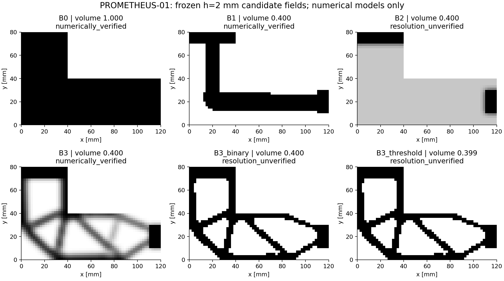
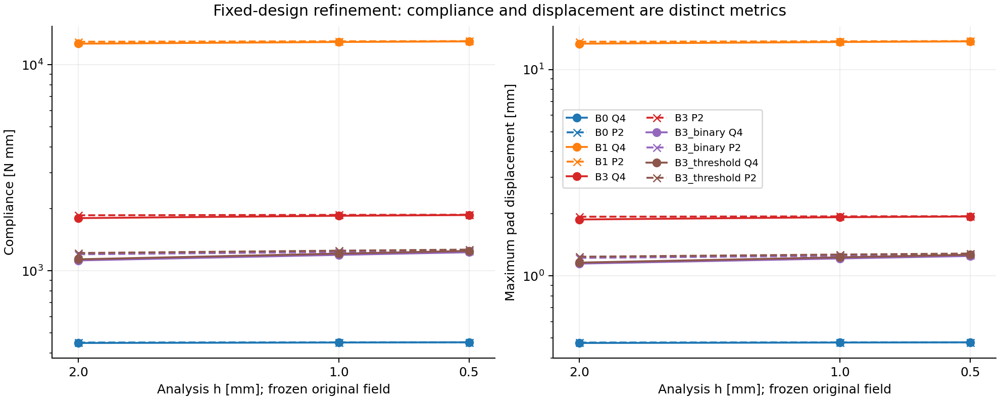
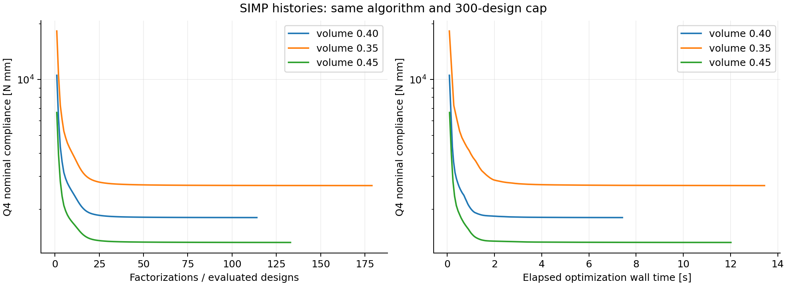

# Phase 1 measured baseline results

Date: 2026-10-10. These are local numerical measurements, not physical test results. The canonical evidence is [phase1_v040_verified/summary.json](../results/phase1_v040_verified/summary.json); the failed earlier attempt is retained separately. No result below establishes safety or manufacturing feasibility.

## Canonical 40% volume result

SIMP converged after **114 evaluated designs**, including initialization, in both repeated runs. The final objective was 1,802.4530264374 N mm on its optimization Q4 mesh. Maximum last raw change was .00898742 and last-eleven objective spread .000204500; the required ten-change convergence window passed. Final design was also the best evaluated incumbent. Actual physical volume fraction was .3999999990844. Raw and physical arrays and every numerical history field were bit-identical between repeats after excluding times. Physical-array SHA-256: `f00a2dc231922ff0bc82834884080540986948ee026f828b849c1753bfc11219`.

The table separates representations. Q4 h2 is the cheap model. P2 h.5 is the finest independent calculation; its presence alone does not grant acceptance. `Verified` below means the declared nominal compliance/pad-displacement gates, not all output metrics or physical behavior.

| Candidate | Representation | Volume fraction | Q4 h2 C [N mm] | P2 h.5 C [N mm] | P2 h.5 max pad displacement [mm] | Full numerical audit |
|---|---|---:|---:|---:|---:|---|
| B0 | Full solid | 1.000000 | 446.533 | 450.330 | .47658 | Verified; outside mass budget |
| B1 | Simple binary L-path | .400000 | 12,658.591 | 13,027.747 | 13.74115 | Verified |
| B2 | Initial density | .400000 | 10,538.993 | — | — | Coarse diagnostic only |
| B3 | Optimized density | .399999999 | 1,802.453 | 1,872.108 | 1.94635 | Verified |
| B3_binary | Exact-mass ranked binary | .400000 | 1,123.267 | 1,248.481 | 1.26508 | Resolution unverified |
| B3_threshold | rho>=.5 binary | .399375 | 1,137.603 | 1,267.910 | 1.28323 | Resolution unverified |

B0 mass is 86.4 g; B1 and B3_binary are 34.56 g. B3_threshold is 34.506 g and is not the exact-mass comparison. The optimized grey indicator is .500274, versus .889365 for B2 and zero for binaries. Thus the density solution has substantial intermediate density; it is not a literal solid part. At h2 the C/Csolid ratios are B1 28.3486, B2 23.6018, B3 4.03655, B3_binary 2.51553 and B3_threshold 2.54763, for their respective declared coefficient models.

## What verification changes

All four canonical binary geometries pass edge connectivity and preserve both pads. All completed solver calls pass their algebraic checks. Five of six candidates meet their own model's volume/pad/geometry/algebraic predicates; B0 exceeds the mass budget. Only **two of these five**, B1 and B3, pass the complete independent nominal-response audit. B2 was intentionally not fully audited. Among the two equal-mass binary alternatives, **one of two** is accepted.

| Candidate | Q4 C change h1→h.5 | P2 C change h1→h.5 | Finest Q4/P2 C gap | Q4 pad change | Result |
|---|---:|---:|---:|---:|---|
| B0 | .2260% | .1026% | .0969% | .2143% | Pass |
| B1 | .7018% | .2252% | .3082% | .7035% | Pass |
| B3 | .8471% | .1782% | .3289% | .8112% | Pass |
| B3_binary | **2.9017%** | **1.1573%** | **1.4274%** | **2.7080%** | Fail resolution gates |
| B3_threshold | **2.9752%** | **1.1826%** | **1.4637%** | **2.7871%** | Fail resolution gates |

Compliance thresholds are <1%; pad displacement thresholds are <2%. Full records include both refinement steps, all P2 pad gaps, and monotonicity/trend checks. No threshold was relaxed after observing the reconstructions. The B3_binary coarse prediction increases from 1,123.267 to 1,248.481 N mm in the finest P2 calculation, approximately **11.15% above the coarse prediction**. Its final refinement remains too large to treat that finest value as an accepted reference.

Raw compliance ordering B3_binary before B1 does **not reverse**. The acceptance decision changes: an audited-only rule retains B1 because B3_binary is unresolved. This is evidence that a finite coarse solve cannot stand in for numerical verification. It is not evidence that B3_binary is physically inferior, that its exact solution would rank behind B1, or that a learned selective verifier would help. Indeed B1's 13.74 mm pad displacement at 1,000 N makes small-deformation physical interpretation questionable despite its numerical acceptance.

## Separate displacement, stress and angle diagnostics

For B3 at Q4 h.5, maximum displacement over all nodes is 2.00927 mm, maximum over rho>=.9 material nodes is 1.94023 mm, and nominal load-weighted displacement C/F is 1.86595 mm. None is a stress measure. The P2 maximum pad displacement is 1.94635 mm. The canonical full-solid Q4 all-node maximum is .49561 mm, larger than its pad maximum .47614 mm.

| Candidate | Q4 peak stress h2→h1→h.5 [MPa] | Regular-region P95 h2→h1→h.5 [MPa] |
|---|---|---|
| B0 | 194.45 → 265.79 → 363.11 | 56.76 → 56.67 → 56.82 |
| B1 | 1,087.93 → 1,487.34 → 2,026.82 | 625.01 → 644.20 → 625.34 |
| B3 | 380.08 → 537.63 → 746.37 | 166.06 → 164.44 → 165.39 |
| B3_binary | 330.71 → 475.49 → 671.57 | 124.58 → 129.58 → 130.92 |
| B3_threshold | 331.18 → 476.33 → 693.24 | 126.68 → 131.42 → 133.27 |

Unrestricted peaks rise sharply with refinement. These values are not strength limits; the singular corners and pixel boundaries prevent a peak-based safety conclusion. The regular region uses the declared fixed physical exclusions; it does not remove every new pixel corner. No stress metric has a full independent stress-verification or physical-validation label.

The exact [-20°,20°] envelope for each stored discrete model has an interior maximum. Finest P2 diagnostic maxima are B0 476.654 N mm at -14.074°, B1 13,691.860 at -12.929°, B3 1,960.489 at -15.291°, B3_binary 1,265.263 at -8.966°, and B3_threshold 1,282.037 at -8.159°. Exact angular maximization does not make the underlying spatial approximation exact. The acceptance gates explicitly cover nominal compliance and nominal pad displacement; angular maxima have not received a separate resolution gate.

With B3's field frozen at h2, changing Emin/E from 1e-6 to 1e-8 changes C from 1,802.453 to 1,802.492 N mm (+.00217%); changing it to 1e-4 gives 1,799.207 (-.18011%). Neither reaches the predeclared 1% ersatz-dependence flag. This does not remove the need to analyze the binary reconstructions separately.

## Costs and comparison scope

Canonical end-to-end recorded wall time is **94.02 s**, CPU time 74.09 s and peak process working set 1.986 GiB. The two optimization runs took 7.44 s and 7.22 s. This is one machine/session, not a stable performance benchmark. Five full candidate audits plus the coarse B2 diagnostic use 31 factorizations / 62 RHS. The two optimizer repeats use 228/228; two ersatz checks 2/4; the two ten-direction derivative sweeps 202/202. Total: **463 completed factorizations and 496 RHS solves**, with no failed canonical audit attempts. Unit-test/development costs and the separate analytical evidence run are outside this benchmark total.

The complete B1 audit took 4.97 s and B3_binary 3.52 s, including their evaluation-stage work but excluding archive compression performed by the runner afterward. Exhausting this two-candidate catalogue is already inexpensive. The fixed-ID/coarse-order replay in [comparisons.json](../results/figures/comparisons.json) reports conditional audit increments; both policies also require the same generation and two cheap screens. Mandatory terminal verification is part of each complete attempt, and unresolved attempts consume their measured cost. These are retrospective deterministic outcomes, not an end-to-end timed strategy comparison. No method speedup or superiority is claimed.

Pure ranking needs no invented response threshold. Response/strength false-feasible rate is **undefined**, not zero: no allowable response or predictive classifier exists. The measured 1/2 equal-mass binary acceptance attrition in the canonical case is reported as resolution attrition, not physical failure or a trained classifier's false-feasible rate.

## Predefined volume sensitivity settings

All three settings use the same physical radius and 300-design cap. Each optimization converged under the unchanged stopping test; the final design was its best evaluated incumbent. No statistical robustness claim follows from these three related cases.

| Volume budget | Evaluated designs | Final Q4 h2 density C | Finest P2 density C | B1 audit | B3_binary audit | Equal-mass binary selected after audit |
|---:|---:|---:|---:|---|---|---|
| .35 | 179 | 2,680.663 | 2,798.787 | Resolution unverified | Geometry failed | None |
| .40 | 114 | 1,802.453 | 1,872.108 | Verified | Resolution unverified | B1 |
| .45 | 133 | 1,323.368 | 1,368.208 | Verified | Resolution unverified | B1 |

Compliance units are N mm. Every B3 density field passes its own complete nominal-response audit. The [35% evidence](../results/phase1_v035/summary.json) shows B3_binary has three components and 36 mm² of unsupported/disconnected retained material; B3_threshold has four components and 24 mm². Both preserve the pads but fail the rule that **all** retained material must be edge-connected to the supported component. They are rejected before a stiffness solve and are not silently repaired. The 35% B1 Q4 final compliance change is 1.3371%, exceeding the 1% gate. Its finest P2 C=21,240.023 is diagnostic and not an accepted reference.

The [45% evidence](../results/phase1_v045/summary.json) gives B3_binary Q4 h2 C=977.941 versus finest P2 1,060.790 N mm. Its Q4 final compliance change is 2.1800%, pad change 2.0313%, and finest compliance gap 1.0317%; it remains unresolved. B3_threshold has actual fraction **.4525**, 80 mm³ / .216 g above the .45 budget, as well as a 2.0250% final Q4 compliance change. That mass violation remains explicit; its lower nominal C does not qualify it to win an equal-mass comparison.

| Volume | Model/constraint feasible out of 6 | Mass-compliant and fully verified | Valid binary geometries out of 4 | Verified equal-mass binaries out of 2 |
|---:|---:|---:|---:|---:|
| .35 | 3 | 1 | 2 | 0 |
| .40 | 5 | 2 | 4 | 1 |
| .45 | 4 | 2 | 4 | 1 |

Model feasibility includes density B2/B3 under their respective relaxed models and is not a count of buildable parts. Binary geometry counts include the full-solid B0 even though it violates mass. The best accepted density compliances are the B3 values above; the best accepted equal-mass binary compliances are undefined at .35, B1=13,027.747 at .40 and B1=6,795.049 at .45. There is no pooled cross-volume winner.

The two comparable measured binary pairs at .40/.45 show no raw compliance rank reversal; the .35 pair has no B3_binary response because geometry fails. Across the settings, admission after audit changes from the coarse-screen choice to B1 or abstention. This outcome is numerical/geometry rejection, not evidence of physical false feasibility.

The fixed-ID versus coarse-objective replay accepts B1 after one full audit at .40/.45 under fixed ID; coarse-objective order first audits unresolved B3_binary and must abstain until it audits B1. At .35 both policies ultimately abstain. At two attempts both policies have the same information and outcome. The postprocessing uses an explicit 2% relative reporting margin for close comparisons, motivated by the two 1% gates, **not a certified error interval or a preregistered algorithmic rule**. It was introduced during report generation, never used to tune designs, and does not affect any reported winner because the valid pairs are widely separated. A fair future learned-method study still requires the protocol's stronger comparators and equal actual budgets, not just equal attempt counts.

| Run bundle | Wall [s] | CPU [s] | Completed factorizations / RHS | Peak working set [GiB] |
|---|---:|---:|---:|---:|
| .40, two repeats + derivative sweeps | 94.02 | 74.09 | 463 / 496 | 1.986 |
| .35, one repeat | 80.39 | 57.30 | 200 / 221 | 1.985 |
| .45, one repeat | 83.93 | 65.58 | 166 / 199 | 1.988 |

There are zero thrown solver/audit exceptions in these completed bundles. The .35 geometry rejections and other resolution failures are separate recorded outcomes; zero exceptions does not mean every candidate passed. Timing differs with machine load and includes repeated full-solid calibration within each separate run. Do not compare these unequal evidence bundles as competing algorithms.

The fixed angle diagnostics (-20°, 0°, +20°) are reproducibly derived from archived Gram matrices in [fixed_angle_diagnostics.json](../results/figures/fixed_angle_diagnostics.json); they do not replace the exact angular maximum.

## Separately reoptimized h=1 mm density field

The measured resource pilot permitted the predeclared separate optimization-grid study. [Its evidence](../results/phase1_h1_reoptimization/summary.json) records **288 evaluated designs**, convergence under the same rules and radius, final/best Q4 h1 objective 1,823.259190 N mm, final raw change .00576945, objective spread .000032966 and physical volume fraction .3999999951. The final field is then frozen during its h1/.5 audit.

At the common finest P2 h.5 analysis, the h1-optimized field gives **1,842.951211 N mm**, compared with 1,872.107811 for the h2-optimized field: a **1.5574% reduction** under that common numerical model. Corresponding pad maxima are 1.918669 versus 1.946353 mm. Comparing their own optimization-grid objective values would confound discretization and design changes; the common comparison avoids that specific error.

For the new field the Q4 h1→h.5 compliance change is .7814%, the P2 change .1185%, and finest inter-solver gap .2894%. Its two-level diagnostic thresholds pass, but its status deliberately remains **resolution_unverified**: no third frozen-field level establishes the refinement trend, and it is not the original h2 candidate. This is evidence of optimization mesh dependence, not proof of a mesh-independent optimum or permission to relabel the h1 result fully verified.

The additional study used 143.30 s wall / 121.63 s CPU, 1.981 GiB peak working set, 292 factorizations and 296 RHS solves, with no thrown audit exceptions. Its 288 optimization calls and four final Q4/P2 factorizations are separate from the canonical budget and fully charged. No h=.5 reoptimization, geometry repair or Phase 2 method was undertaken.
