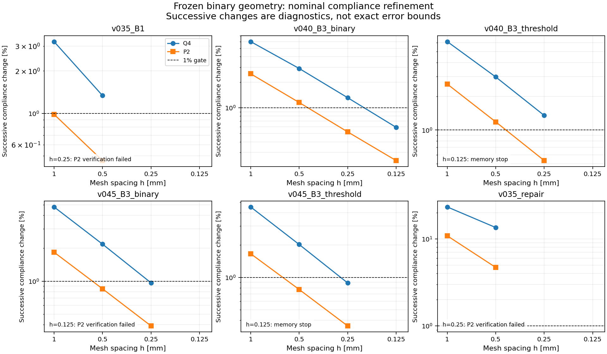

# Phase 1.1 numerical truth audit

This investigation treats a reference as an empirically resolved response of a specified mathematical model. It does not treat the last computed mesh as exact truth. Original Phase 1 geometry, source, failed attempts and labels remain separate historical evidence.

## Existing baseline and scope

The [reproduction report](../results/phase11/reproduction.json) confirms exact scientific agreement for all four documented jobs: the .40 benchmark with two optimization repeats and derivatives, .35 and .45 benchmarks, and h1 reoptimization. Comparisons include optimization histories/stopping, evaluation metrics and diagnostics, failures, verification labels and saved `.npy` arrays. Timing and process memory are excluded from equality. The original six test files passed **104 tests** in the [baseline replay](../results/phase11/tests_baseline.xml). The manufactured-solution [validation replay](../results/phase11/validation_replay.json) again passed its checks; Q4 L2 rates are 1.9960/1.9990 and P2 rates 2.9955/2.9989. The old reports and archives are not regenerated in place.

The primary catalogue contains 12 original binary entries: B0, B1, B3_binary and B3_threshold at each of .35/.40/.45. B0 is the same full-solid calibration geometry repeated under three budgets. The h1 reoptimization archive contains a density candidate, not an additional binary reconstruction. The earlier aborted canonical run contains no additional archived binary candidate. One separately identified .35 repair is added; all 21 threshold-sweep masks are geometry-only studies. [Catalogue and provenance](../results/phase11/geometry/catalog.json), [binary audit](BINARY_GEOMETRY_AUDIT.md).

The unchanged synthetic model uses N and mm, E=70,000 N/mm², nu=.30, thickness 5 mm, and density 2.70e-6 kg/mm³. The L domain occupies 6,400 mm² inside a 120×80 mm box with 40-mm legs. The complete support and load pads are preserved; the top support segment fixes both in-plane translations. A consistent traction on the declared right-edge segment has total magnitude 1,000 N. The primary solver uses fully integrated bilinear Q4 elements. The separate verifier uses quadratic triangles, separate assembly/traction/constitutive implementation, and the same SciPy sparse linear-algebra backend. This is cross-discretization verification, not an independent experimental validation or a completely separate software stack.

## Protocol and interpretation

The [reference-label protocol](REFERENCE_LABEL_PROTOCOL.md) predates fine calculations. The [committed execution plan](../results/phase11/refinement/plan.json) clarifies before those calculations that any failing declared angle can trigger refinement of a connected candidate, including an originally nominal-accepted comparator. The protocol's general B0/B1 exemption must be read with that clarification; it never grants a new-angle pass. No acceptance threshold changes.

The mesh sequence is h=2,1,.5,.25,.125,.0625 mm, conditionally stopped when all three angle audits pass, an attempt fails/resources defer, or the sequence is exhausted. Reference gates use the last three consecutive halvings: Q4 and P2 last compliance changes <1%, pad-displacement changes <2%, finest same-h gaps <1%/<2%, decreasing compliance changes, nondecreasing compliance with the existing roundoff allowance, and the original raw algebraic checks. Geometry, budget, numerical acceptance and overall eligibility are different predicates. The three scenario angles are -20°, 0° and +20°, evaluated from the two already-solved basis RHS without extra factorization. Projected records retain raw basis Gram matrices and solver diagnostics; any retained legacy stress fields remain nominal and are not new-angle stress evaluations.

Uniform refinement subdivides the **same exact union of h2 solid squares**. It neither smooths its boundary nor converges toward a different manufactured shape. The domain and coefficients remain fixed; the displacement approximation is refined. Sharp pixel corners and short retained runs can demand more resolution than the density model, whose intermediate coefficients and positive ersatz stiffness describe another problem. Good linear-system residuals are necessary but do not bound spatial discretization error. Conversely, a failed algebraic check prevents a reference label even if an apparent response trend looks favorable.

These empirical gates provide an accepted numerical estimate, not a rigorous continuum-error certificate. No Richardson extrapolation, arbitrary finest-mesh designation, stress limit, physical safety threshold or manufacturing requirement is substituted for the declared criteria.

## Measured results

The complete per-level record is [responses.csv](../results/phase11/refinement/responses.csv), with [full response records and labels](../results/phase11/refinement/labels.json). The [candidate table](../results/phase11/tables/candidate_results.csv) separates reference estimates from last observed values and records geometry, volume, feature diagnostics and costs. A null result means unmeasured/unresolved, never zero response. The [cost ledger](../results/phase11/tables/evaluation_costs.csv) retains failures and notes shared-angle costs.

The nominal table covers every original binary and the repair. Delta/gap columns use the **last completed paired level**, which is not necessarily an accepted reference. They are percentages. Minimum axis run is a raster diagnostic, not Euclidean ligament thickness. Full pad changes, all angles and provenance appear in the linked CSV.

| Catalogue | Fraction | Components | Min. run mm | Last paired h | Observed P2 C [N mm] | Delta Q4 % | Delta P2 % | Gap % | Final classification |
|---|---:|---:|---:|---:|---:|---:|---:|---:|---|
| v035_B0 | 1.000000 | 1 | 40 | 0.500 | 450.330 | 0.226 | 0.103 | 0.097 | constraint_over_budget |
| v035_B1 | 0.350000 | 1 | 8 | 0.500 | 21240.023 | 1.337 | 0.462 | 0.623 | unresolved |
| v035_B3_binary | 0.350000 | 3 | 2 | — | — | — | — | — | geometry_rejected |
| v035_B3_threshold | 0.336250 | 4 | 2 | — | — | — | — | — | geometry_rejected |
| v040_B0 | 1.000000 | 1 | 40 | 0.500 | 450.330 | 0.226 | 0.103 | 0.097 | constraint_over_budget |
| v040_B1 | 0.400000 | 1 | 8 | 0.500 | 13027.747 | 0.702 | 0.225 | 0.308 | numerically_accepted |
| v040_B3_binary | 0.400000 | 1 | 2 | 0.125 | 1258.073 | 0.591 | 0.241 | 0.284 | numerically_accepted |
| v040_B3_threshold | 0.399375 | 1 | 2 | 0.250 | 1274.721 | 1.350 | 0.534 | 0.649 | unresolved |
| v045_B0 | 1.000000 | 1 | 40 | 0.500 | 450.330 | 0.226 | 0.103 | 0.097 | constraint_over_budget |
| v045_B1 | 0.450000 | 1 | 10 | 0.500 | 6795.049 | 0.531 | 0.184 | 0.236 | numerically_accepted |
| v045_B3_binary | 0.450000 | 1 | 4 | 0.250 | 1064.941 | 0.966 | 0.390 | 0.456 | unresolved |
| v045_B3_threshold | 0.452500 | 1 | 4 | 0.250 | 1043.507 | 0.888 | 0.354 | 0.420 | constraint_over_budget |
| v035_repair | 0.344375 | 1 | 2 | 0.500 | 32785.860 | 13.492 | 4.697 | 7.896 | unresolved |

B0 has resolved mechanics but is over budget. The .45 threshold mask is over budget **and** numerically unresolved. The other over-budget labels do not imply eligibility.

Every new attempt is below. Partial Q4 responses are preserved even when P2 failed; they do not establish paired acceptance. A dash after termination means no returned result, never zero response.

| Candidate | h mm | Q4 C [N mm] | P2 C [N mm] | Wall s | Peak GiB | Attempt status |
|---|---:|---:|---:|---:|---:|---|
| v035_B1 | 0.250 | 21228.324 | — | 29.70 | 2.267 | independent_verification_failed |
| v040_B3_binary | 0.250 | 1247.086 | 1255.044 | 26.70 | 2.099 | evaluated |
| v040_B3_binary | 0.125 | 1254.502 | 1258.073 | 288.45 | 6.956 | evaluated |
| v040_B3_threshold | 0.250 | 1266.443 | 1274.721 | 24.68 | 2.081 | evaluated |
| v040_B3_threshold | 0.125 | — | — | 140.28 | 8.256 | memory_limit |
| v045_B3_binary | 0.250 | 1060.083 | 1064.941 | 24.83 | 2.535 | evaluated |
| v045_B3_binary | 0.125 | 1064.679 | — | 172.94 | 7.744 | independent_verification_failed |
| v045_B3_threshold | 0.250 | 1039.126 | 1043.507 | 23.00 | 2.553 | evaluated |
| v045_B3_threshold | 0.125 | — | — | 186.45 | 8.118 | memory_limit |
| v035_repair | 2.000 | 20044.460 | 27858.563 | 6.56 | 0.079 | evaluated |
| v035_repair | 1.000 | 26122.898 | 31245.965 | 13.63 | 0.129 | evaluated |
| v035_repair | 0.500 | 30197.130 | 32785.860 | 4.83 | 0.379 | evaluated |
| v035_repair | 0.250 | 32269.454 | — | 15.95 | 1.723 | independent_verification_failed |

The [schedule table](../results/phase11/tables/refinement_schedule.csv) accounts for all conditional levels through h=.0625, including levels not attempted after failure or complete acceptance. No .0625 solve was needed or reached under the stop rule. All original h2/h1/h.5 results remain in [responses.csv](../results/phase11/refinement/responses.csv).

For v040_B3_binary, the accepted window is .5/.25/.125. Nominal Q4 compliance changes fall from 1.3172% to .5911%; P2 changes fall from .5230% to .2408%. Last pad changes are .5538%/.2272%, and finest compliance/pad gaps are .28385%/.26529%. Both compliance sequences are nondecreasing and raw algebraic checks pass. P2 compliance **1258.072871 N mm**, pad maximum **1.274243 mm**, is therefore an accepted empirical estimate. This supplies a convergence argument under the declared gates, not an exact-mesh assertion.

### Failures and resources

The .35 B1 and repair fail P2's unchanged free-DOF residual gate at h=.25 after LU and both basis RHS solves. The norm is relative to max(||f_free||2,1), with threshold 1e-8. The original kernel did not return rejected residual values or identify the offending RHS. Their precise magnitude is unknown. A future instrumented backward-error/iterative-refinement study could investigate scaling and roundoff; this audit establishes neither a condition number nor a successful retry. [B1 record](../results/phase11/refinement/attempts/v035_B1/h0.25/record.json), [repair record](../results/phase11/refinement/attempts/v035_repair/h0.25/record.json).

The .45 ranked h=.125 exception occurs after P2 splu returns, while accessing factor.U for pivot inspection. It requests 294,626,640 float64 values: 2,357,013,120 bytes (2.195 GiB). The traceback establishes post-factorization memory failure, not the pivot ratio, conditioning, singularity or exact factor-buffer ownership. P2 RHS solves had not run. [Exception evidence](../results/phase11/refinement/attempts/v045_B3_binary/h0.125/record.json).

The .40/.45 threshold children stop at the observed 8-GiB working-set ceiling. Polling can overshoot before termination and is not an OS hard limit. Their scalar results and completed-stage counts are unavailable. Preflight estimates assembly allocation, not factorization fill or subsequently exposed factor arrays; passing it does not guarantee sufficient total memory. No successful older value replaces a failed terminal attempt in the final label.

There were **13 new attempts: eight complete paired evaluations and five unsuccessful attempts**, totaling **957.992 s**. Source-path accounting establishes **22 completed factorizations and 42 RHS columns**, plus unknown work in two terminated workers. The [derived cost ledger](../results/phase11/tables/evaluation_costs.json) preserves raw counters and adds demonstrably completed P2 stages. Failed work is already included in elapsed time, not charged twice.

Baseline replays cost **395.315 s**; validation adds **4.099 s and 14 factorizations/14 RHS**. Geometry auditing/generation costs **1.774 s**, and angle projection **2.232 s**, both without FEM solves. Kinematic postprocessing costs 17.455 s plus 1.831 s for the repair. The earlier CSV-export failure has unknown elapsed time, explicitly null. The [consolidated costs](../results/phase11/final_evaluation_costs.csv) include table/figure postprocessing; they are not a complete measurement of assistant wall time.

### Additional predefined settings and ranking

[All angle labels](../results/phase11/refinement/labels.json), [rankings](../results/phase11/tables/rankings.json), and [h=.25 checkpoints](../results/phase11/angle_checkpoints.json) distinguish raw ordering from eligibility. At .45, nominal and -20° checks pass at .25, but +20° Q4 compliance changes are **1.1353%** for the ranked mask and **1.0409%** for the threshold mask. The predeclared all-angle rule triggers .125; its failure leaves the final references unresolved. Nominal-only checking would miss this distinction.

| Budget | Eligible order at -20° | At 0° | At +20° |
|---:|---|---|---|
| .35 | None | None | None |
| .40 | B3_binary, then B1 | B3_binary, then B1 | B3_binary, then B1 |
| .45 | B1 only | B1 only | B1 only |

Canonical B3_binary estimates are 1247.843/1258.073/1113.345 N mm at -20/0/+20°, versus B1's 13490.852/13027.747/9771.822. The accepted linear-model ordering persists, with separation beyond the reporting-only 2% tie margin. Unresolved candidates are excluded from eligible order; apparent closeness is not a certified tie or winner.

Raw observed order **does not persist everywhere**. At .35 on the common last paired h=.5 mesh, repair/B1 compliance is 19273.334/22216.819 at -20°, 32785.860/21240.023 at 0°, and 41020.683/15783.998 at +20°. The order reverses. Both remain unresolved, and repair uses less mass, so this is finite-mesh loading sensitivity, not reference-quality superiority. Geometry/budget exclusions are angle-independent. These correlated settings do not establish generalization to other geometry families or physical-model validity.

## Density-to-binary discrepancy

Passing the density-model audit does not transfer to a new binary problem. SIMP uses E(rho)=Emin+rho³(E0−Emin) over all domain cells. Ranked reconstruction selects an exact number of solid cells; threshold reconstruction selects rho>=.5 and overrides pads. Both remove void cells for mechanics. These operations change stiffness distribution and possibly connectivity without optimizing the binary problem itself.

At .35, the ranked reconstruction has three edge components and the threshold version four; both complete pads lie in the main component, but retained islands violate the original geometry rule. Their responses are not accepted or fabricated. At .40/.45, both original reconstructions are edge-connected without local point contacts. Their Phase 1 failure mechanism is instead assessed by the measured refinement chains. The .45 threshold version independently violates the volume budget (.4525 versus .45), so even resolved mechanics cannot make it eligible. [Measured geometry/mass evidence](BINARY_GEOMETRY_AUDIT.md).

The single repair removes the .35 ranked mask's floating 36 mm², creates a new immutable identity, retains 2,204 mm² and changes the volume fraction to .344375. It is an under-budget new geometry, not a retroactive repair or exact-mass replacement of the old candidate. Generation and all attempted verification are charged. Threshold-sweep masks have their own identities and no inherited mechanics acceptance.

## Large-displacement model limitation

The [kinematic audit](KINEMATIC_AUDIT.md) evaluates H=grad(u), infinitesimal strain sym(H), and omitted term Q=.5 H.T H on archived Q4 h=.5 linear fields. For canonical B1, maximum displacement is 13.6986 mm, 11.42% of 120 mm; ||Q||L2/||sym(H)||L2 is 2.465 globally and 2.397 outside the original 6-mm singular-location exclusions. This is not a small correction in the sampled solution, so small-deformation kinematics are not a defensible quantitatively accurate physical-response approximation for B1 at the stated load without a nonlinear comparison. The linear problem remains a well-defined numerical benchmark.

The canonical ranked binary's analogous regular ratio is .132868 and displacement/120 is 1.0402%. That is much smaller than B1's result, but is not a validation threshold or a nonlinear response-error bound. The regular mask does not remove all new pixel corners. No new physical-validity criterion is invented. A resolved linear compliance cannot establish that the geometrically linear model represents an actual loaded part accurately.

An objective geometrically nonlinear plane-stress equilibrium study with explicit constitutive law, load-following convention, incremental loading and independent benchmark checks is the appropriate next model comparison. Tensor objectivity and total/updated Lagrangian distinctions are documented by [COMSOL](https://doc.comsol.com/6.4/doc/com.comsol.help.sme/sme_ug_theory.06.009.html) and [Bathe's MIT lecture](https://ocw.mit.edu/courses/res-2-002-finite-element-procedures-for-solids-and-structures-spring-2010/resources/lecture-16/). This recommendation is an inference from the measured kinematic discrepancy. Adding Q to an old strain field does not solve new equilibrium. No safe load is extrapolated and no physical failure is concluded.

The repaired .35 geometry is more extreme: its successful partial Q4 h=.25 field has nominal maximum displacement **43.9518 mm** (36.63% of 120 mm) and regular quadratic/linear strain-norm ratio **53.28**. Its P2 failure remains unresolved. The [repair kinematic addendum](../results/phase11/kinematics/repair/records.json) strengthens the need for nonlinear comparison; these large corrections are not nonlinear equilibrium results or physical failure criteria.

## Reproduction and decision

[Phase 1.1 reproduction instructions](PHASE1_1_REPRODUCE.md) identify commands, immutable inputs and fresh destinations. [Phase 1.1 decision](PHASE1_1_DECISION.md) states what the evidence supports, remaining limitations, test results and the selective-verification recommendation. Numerical labels apply only to the declared angle's compliance and maximum pad displacement; no stress, continuous-angle kinematic, physical or manufacturing label is implied.
